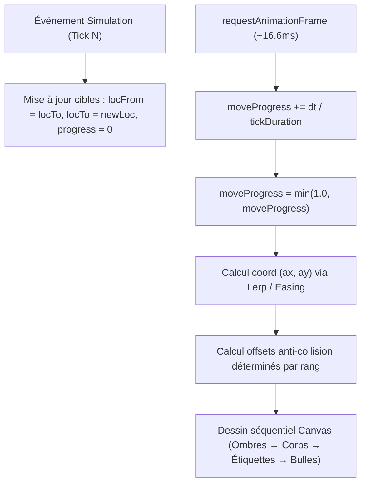

# Spécification Technique — Moteur Visuel 2D HAMEAU (SPEC.md)

Ce document formalise les spécifications techniques du rendu visuel 2D des agents dans le visualiseur Hameau, conformément aux exigences du hackathon et au plan d'art direction validé en Phase P1.

---

## 1. Schéma des Données Consommées par le Renderer

Le renderer vectoriel (`CharacterRenderer2D`) consomme l'état interne issu du replay de la simulation (`this.agentsState` dans `viewer/app.js`) enrichi à chaque tick :

```typescript
interface AgentRenderState {
  id: string;               // Identifiant unique : "awa", "kofi", "samuel", etc.
  name: string;             // Nom d'affichage : "Awa", "Kofi", etc.
  location: string;         // Lieu actuel cible : "boulangerie", "marche", etc.
  previousLocation?: string;// Lieu précédent pour interpolation spatiale
  moveProgress: number;     // Progression de marche entre 0.0 et 1.0
  facing: "left" | "right"; // Direction du regard / orientation de marche
  action: string;           // Action en cours : "discussion", "recolte", "sommeil", etc.
  dialogue?: string;        // Dernière réplique générée (Bedrock Nova Micro)
  isTalking: boolean;       // True si l'agent s'exprime au tick courant
  believedFacts: Record<string, number>; // Croyances { "R1_...": 0.9, "R2_...": 0.8 }
  inventory: Record<string, number>;    // Stock { "farine": 5, "pain": 2 }
  confidenceZone?: "green" | "yellow" | "red"; // Zone de confiance Decider 2B
  isNight: boolean;         // True si l'horloge du village est entre 22h et 06h
  tick: number;             // Numéro de tick simulation pour synchronisation d'animation
}
```

---

## 2. Cycle de Vie par Tick et Boucle de Rendu (60 FPS)

Le visualiseur fonctionne sur une double cadence :
1. **Cadence logique (Tick simulation)** : Événements cadencés par le timer de lecture (par défaut 400 ms par tick, ajustable de 50 ms à 2 000 ms).
2. **Cadence visuelle (requestAnimationFrame à 60 FPS)** : Interpolation continue indépendante du framerate simulation.



---

## 3. Formule d'Interpolation Spatiale et Trajectoire

Quand un agent change de lieu (`locFrom !== locTo`), ses coordonnées $(x(t), y(t))$ sur le canvas sont lissées à l'aide d'une fonction d'atténuation cubique (*easeInOutCubic*) :

$$t = \text{clamp}\left(\frac{\text{currentTime} - t_{\text{start}}}{T_{\text{tick}}}, 0.0, 1.0\right)$$

$$s(t) = \begin{cases} 
4 t^3 & \text{si } t < 0.5 \\
1 - \frac{(-2t + 2)^3}{2} & \text{si } t \ge 0.5 
\end{cases}$$

$$\vec{P}(t) = (1 - s(t)) \cdot \vec{P}_{\text{from}} + s(t) \cdot \vec{P}_{\text{to}}$$

### Orientation du regard (*Facing*)
- Si $P_{\text{to}}.x > P_{\text{from}}.x$, l'agent regarde vers la droite (`scaleX = 1`).
- Si $P_{\text{to}}.x < P_{\text{from}}.x$, l'agent regarde vers la gauche (`scaleX = -1`).
- En position stationnaire, l'agent regarde vers le centre du lieu ou vers son interlocuteur si `isTalking`.

---

## 4. Algorithme d'Anti-Collision Déterministe (Zéro Chevauchement)

### Problème résolu
Dans la version baseline (points), jusqu'à 6 agents pouvaient se trouver simultanément sur la « Place du Marché », leurs cercles et leurs étiquettes textuelles se superposant de manière illisible.

### Règle d'agencement géométrique
Pour tout nœud $L$ ayant un rayon d'icône $R_{\text{loc}} = 24 \text{ px}$ et accueillant $K$ agents ordonnés de façon stable par leur `id` alphabétique :

1. **Si $K = 1$** :
   $$\Delta x = 0, \quad \Delta y = R_{\text{loc}} + 20 \text{ px}$$
2. **Si $2 \le K \le 5$ (Disposition en Arc de Cercle Inférieur)** :
   Les agents sont disposés sur un arc sous le lieu, évitant de masquer l'icône et le titre du lieu situés au-dessus :
   $$\theta_i = \pi \cdot \left(0.15 + 0.70 \cdot \frac{i}{K - 1}\right), \quad R_{\text{arc}} = 42 \text{ px}$$
   $$\Delta x_i = R_{\text{arc}} \cdot \cos(\theta_i), \quad \Delta y_i = R_{\text{arc}} \cdot \sin(\theta_i) + 8 \text{ px}$$
3. **Si $K > 5$ (Disposition en Double Arc Étagé)** :
   - Rang 1 ($i < 4$) : Rayon $R_1 = 38 \text{ px}$
   - Rang 2 ($i \ge 4$) : Rayon $R_2 = 64 \text{ px}$, en quinconce pour préserver la silhouette de chaque tête.

### Découplage des Étiquettes Textuelles
- **Titre du lieu** : Placé au-dessus du nœud : $(x_{\text{loc}}, y_{\text{loc}} - R_{\text{loc}} - 14 \text{ px})$.
- **Nom de l'habitant** : Placé directement sous les pieds du personnage : $(x_{\text{agent}}, y_{\text{agent}} + 6 \text{ px})$.
- **Bulle de dialogue** : Flottant au-dessus de la tête $(x_{\text{agent}}, y_{\text{agent}} - 68 \text{ px})$ avec ancre triangulaire pointant sur la chevelure.

---

## 5. Matrice de Mapping États Simulation → Variantes Visuelles

| État Simulation | Déclencheur Données | Traduction Graphique / Cinématique | Priorité Visuelle |
| :--- | :--- | :--- | :---: |
| **Marche (`walk`)** | `locFrom !== locTo` && `progress < 1.0` | Foulée vive, balancement bras/jambes, rebond vertical | 1 (action prioritaire) |
| **Discussion (`talk`)** | `a.isTalking === true` | Gesticulation oratoire, bouche articulée, bulle de dialogue stylisée | 2 |
| **Rumeur R1 (`rumor`)** | `believedFacts["R1..."] > 0` | Regard furtif gauche/droite, posture défensive, halo rose-rouge `#f43f5e` | 3 |
| **Démenti R2 (`debunk`)** | `believedFacts["R2..."] > 0` | Grand soupir de soulagement, épaules relâchées, halo cyan `#06b6d4` | 3 |
| **Stockage (`stock`)** | `inventory.farine > 2` ou action `stocker` | Torse incliné sous le poids, panier plein ou sacoche volumineuse | 4 |
| **Doute Décisionnel (`hesitate`)** | `confidenceZone === "red"` | Pose du penseur (main au menton), regard en l'air, pied battant | 4 |
| **Sommeil / Nuit (`night`)** | `currentHour >= 22` \|\| `< 6` | Respiration lente 0.035Hz, yeux clos, filtre obscurité nocturne | 5 |
| **Repos (`idle`)** | Défaut stationnaire | Respiration abdominale 2.2px, balancement de hanche organique | 6 |

---

## 6. Architecture Modulaire et Intégration

Le fichier `viewer/character_renderer.js` est structuré sans dépendance :
- `HAMEAU_CHARACTERS` : Dictionnaire complet des 12 fiches personnages (couleurs OKLCH, styles de cheveux, silhouettes, accessoires).
- `CharacterRenderer2D` : Moteur de dessin Canvas exposant deux méthodes publiques :
  1. `draw(ctx, charDef, state, opts)` : Rendu plein pied ou buste.
  2. `drawDialogueBubble(ctx, text, x, y, width)` : Bulle éditoriale stylisée avec fond parchemin clair ou ardoise sombre.
- Dans `viewer/index.html` :
  ```html
  <script src="character_renderer.js"></script>
  <script src="app.js"></script>
  ```
- Dans `viewer/app.js` :
  - Ajout d'une instance `this.charRenderer = new CharacterRenderer2D();`
  - Bascule propre `this.viewMode = "characters" | "dots"` configurable via un bouton discret pour comparer instantanément l'avant et l'après.
